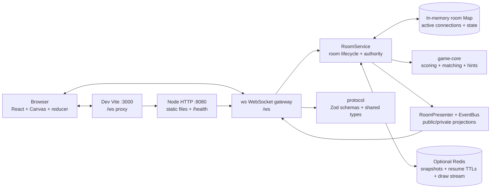

# Technical Requirements Document

## Sketch League - Multiplayer Drawing and Guessing Game

**Status:** Implemented assignment MVP with explicit production seams

**Purpose:** Explain the architecture that is actually in the repository, the guarantees it provides, and the work required before operating it as a large public service.

## 1. Implementation snapshot

| Area | Implemented choice |
| --- | --- |
| Language | TypeScript end to end |
| Browser | React 19, Vite 6, HTML Canvas, reducer-based session state |
| HTTP | Node `http` server with a small static-file handler and `/health` endpoint |
| Realtime | `ws` WebSocket server on `/ws` |
| Validation | Shared Zod schemas in `packages/protocol` at the server boundary |
| Game rules | Pure helpers and a self-test in `packages/game-core` |
| Room ownership | One in-memory `Map` per Node process; one process is authoritative for a room |
| Persistence | In-memory snapshots always; optional Redis 7 snapshots, resume keys, and drawing event streams |
| Deployment | One `game` container serving the built web app and WebSocket API, plus Redis in Docker Compose |
| Authentication | None. Display names are anonymous; resume tokens are short-lived opaque session tokens |

There is no Fastify, database ORM, broker, distributed room lease, or separate web container in the current project. Those are production options, not implementation claims.

## 2. System architecture



### Runtime topology

- In development, Vite serves the browser at `http://localhost:3000` and proxies `/ws` and `/health` to the Node server at port 8080.
- In the Docker Compose path, the `web` container runs Vite on port 3000 and proxies `/ws` and `/health` to the `game` backend. The `game` container also builds the static web bundle and serves it from port 8080 as a fallback, while owning `/ws`.
- Redis is optional. If `REDIS_URL` is absent or Redis cannot be reached during startup, the server logs `in-memory recovery mode` and continues with process-local state.
- The current implementation is single-process for room ownership. Two processes can both accept WebSocket traffic, but they do not share the active-room `Map` or coordinate mutations. Horizontal scaling is therefore a future architecture, not a current guarantee.

## 3. Repository boundaries

```text
question-1/
  apps/web/src/
    app/                    app shell, lazy screens, reducer, session hook
    features/lobby/         landing and host settings
    features/drawing/       canvas, toolbar, renderer
    features/game/          header, room, scoreboard, replay, results, invite
    features/chat/          chat panel
    shared/                 browser helpers, constants, sounds, view types
  apps/server/src/
    config/                 environment parsing
    http/                   static files and health endpoint
    realtime/               WebSocket gateway and connection context
    rooms/application/      service, presenter, event bus
    rooms/domain/           state factory and runtime types
    rooms/infrastructure/   Redis/in-memory repository
  packages/protocol/src/    Zod input schemas and shared public types
  packages/game-core/src/   scoring, masking, normalisation, near-miss logic
  tests/smoke.mjs           multi-client behavioral test
  tests/load.mjs            synthetic fan-out latency harness
```

The browser screens for the lobby and game are lazy-loaded. The server bootstrap, WebSocket gateway, room service, persistence adapter, and presenter are separate modules so the game rules can be tested without rendering React.

## 4. WebSocket contract

### Client envelope

The current wire shape is intentionally small:

```json
{
  "type": "draw.operation",
  "requestId": "client-generated-id",
  "payload": { "operation": "..." }
}
```

The server validates the complete message with the discriminated Zod union before dispatching it. There is no protocol version field yet.

### Client commands

```text
room.create            displayName, settings
room.join              roomId, displayName, optional resumeToken
room.resume            roomId, resumeToken, optional lastEventSeq
room.probe             roomId
room.leave             explicit permanent departure
room.settings.update   settings, expectedVersion
room.start             expectedVersion
turn.chooseWord        optionId
draw.operation         stroke | eraser | fill | undo | clear
chat.send              text
room.sync              optional lastEventSeq
```

### Server events

Public and private events use this shape:

```json
{
  "type": "drawing.operation",
  "roomId": "a1b2c3",
  "serverEpoch": "process-epoch",
  "eventSeq": 42,
  "serverTime": 1760000000000,
  "payload": {}
}
```

Private events also carry the original `requestId` when useful. The implemented event families are:

```text
connection.accepted     room.snapshot, room.status, error
player.joined           player.left, player.reconnected, scoreboard.updated
room.settings.updated   turn.started, turn.wordOptions, turn.drawingStarted
turn.secretWord         hint.updated, drawing.operation, chat.message
player.close            guess.accepted, guess.alreadyAccepted, guess.correct
turn.ended              game.ended
```

`room.snapshot` is the recovery primitive. It includes the public player projection, phase, settings, deadlines, masked/revealed word projection, current operations, and replay operations. It never exposes `secretWord` to a non-drawer.

## 5. Server authority and state machine

```text
LOBBY
  room.start (host, >=2 connected) -> CHOOSING_WORD
CHOOSING_WORD
  turn.chooseWord (drawer) -> DRAWING
  choice deadline -> DRAWING using the first option
DRAWING
  all eligible guessers correct -> ROUND_REVEAL
  deadline -> ROUND_REVEAL
  drawer grace expires -> ROUND_REVEAL
  no eligible guesser for five seconds -> ROUND_REVEAL
ROUND_REVEAL
  reveal timer -> next CHOOSING_WORD or GAME_OVER
GAME_OVER
  room is read-only; create a new room for another match
```

`RoomService` is the only application component that mutates `RoomState`. It validates the player identity from the connection context, current phase, expected lobby version, and current deadline before performing an action.

The state contains:

```text
roomId, matchId, serverEpoch, eventSeq, version, phase
settings, wordPool, players, playerOrder, hostPlayerId, hostResumePlayerId
roundNumber, drawnInRound, currentDrawerId
choiceEndsAt, turnStartedAt, turnEndsAt, revealEndsAt
secretWord, wordOptions, hintNumber
operations, replayOperations, replays
guessedPlayerIds, eligibleGuesserIds, drawerGraceEndsAt
scores and lastActivityAt through the player/state projections
```

The current process does not implement an explicit per-room command queue or distributed lock. For the assignment, a single Node process owns the map and the smoke test exercises the critical transitions. A production version should serialize commands per room before adding multiple gateways.

## 6. Trust boundary and security behavior

The browser never sends a score, selected answer, role, timer, or transition as an authoritative field. Specific checks include:

- `room.start` requires the current `hostPlayerId`, `LOBBY`, an exact `version`, and two connected players.
- `room.settings.update` requires the host, `LOBBY`, and an exact version.
- `turn.chooseWord` requires the current drawer and one of the server-issued option IDs.
- `draw.operation` requires the current drawer, `DRAWING`, an unexpired turn, a valid operation schema, and a unique operation ID.
- `chat.send` is normalized on the server. An exact answer is accepted privately and is never published as `chat.message`.
- Scores and guess eligibility are mutated only in `RoomService`.
- The public presenter masks the word during drawing and only reveals it in `ROUND_REVEAL` or `GAME_OVER`.

Resume tokens are random opaque values generated with Node crypto. They are stored in `sessionStorage` in the browser and in Redis (or an in-memory map) with a 30-second expiry. They are not signed JWTs and are not an account credential. TLS, origin checks, authentication, and signed tokens are required for a public deployment.

The current server has schema and connection-level limits, but it does not yet configure a byte-level `ws` `maxPayload`, IP/global token buckets, profanity moderation, or an escalating ban system. Chat is rendered as text in React rather than as HTML.

## 7. Drawing synchronization and replay

### Operation format

Coordinates are normalized to `[0, 1]`, so the same operation can render at different canvas sizes:

```json
{
  "kind": "stroke",
  "id": "op-uuid",
  "tool": "pen",
  "color": "#111827",
  "size": 6,
  "points": [[0.12, 0.44], [0.13, 0.45]]
}
```

The protocol also supports `eraser`, `fill`, `undo`, and `clear`. Point counts, coordinates, colour, size, and operation IDs are schema validated.

### Current delivery path

1. The drawer updates a local `localStroke` while the pointer moves, so the drawer sees no round-trip delay.
2. On pointer-up, the browser sends the complete stroke as one `draw.operation` command.
3. The server validates it, assigns the next `eventSeq` and `serverTime`, appends it to both the current operation list and replay list, and broadcasts the canonical operation.
4. Every browser applies the operation. The renderer rebuilds the canvas from the ordered operation list; undo and clear remain operations instead of deleting history.

This is operation fan-out, not point-chunk streaming. It is reliable for a small-group demo and gives the drawer an immediate preview, but a long stroke is not visible to peers until pointer-up. **Next:** send bounded point chunks during an active stroke, with a final operation for replay.

### Ordering and late joiners

Public broadcasts receive a monotonically increasing `eventSeq` within the room. Drawing operations are assigned their sequence before broadcast. WebSocket ordering is preserved per connection. On join or resume, the client receives a complete snapshot containing current operations, so it does not depend on replaying missed socket packets.

The reducer ignores older snapshot versions and deduplicates drawing operations by ID. `room.sync` exists as a protocol command, but the current browser does not run a general out-of-order buffer or automatically request a sync for every sequence gap. **Next:** add a bounded event-gap buffer and automatic snapshot repair.

Replay stores the canonical operation list for each revealed turn. The browser sorts by `eventSeq` and renders prefixes of the list at 0.5x, 1x, or 2x. The replay renderer resolves undo targets before painting, so an undo behaves consistently in live state and replay.

## 8. Time, liveness, and recovery

The server writes absolute timestamps for choice, turn, and reveal deadlines. A 250 ms server interval calls `RoomService.tick()` to advance timers and publish hints/round transitions. The browser renders a cosmetic countdown using the server event time offset; every authority decision remains server-side.

The WebSocket gateway sends native WebSocket pings from the same 250 ms interval. The `ws` library handles pong frames. A close/error event marks a player offline; there is no separate application-level missed-pong counter in the current implementation.

The browser reconnects after a fixed 1.2 second delay. On open it sends `room.resume` if a room and token exist, otherwise it probes a room URL. A successful resume rotates the token and returns a fresh snapshot. A stale or expired token produces a clear error and the player may join as a new player.

### Host recovery

When the host disconnects, `hostPlayerId` is immediately assigned to the first connected player and a `hostResumePlayerId` reservation keeps the original host's claim for 30 seconds. A valid resume restores the original host and publishes a new snapshot. After the reservation expires, a connected temporary host remains authoritative.

### Minimum-player recovery

During `CHOOSING_WORD`, `DRAWING`, or `ROUND_REVEAL`, fewer than two connected players causes:

- immediate game over for an explicit permanent `room.leave`;
- a reconnect grace period for an ordinary socket/page drop while a player still has a valid 30-second resume token;
- `game.ended` with `reason: "not-enough-players"` once that grace is gone.

The offline player remains in the roster and final ranking, but is removed from current guesser eligibility after five seconds.

### Server restart and failover boundary

With Redis enabled, every important state change saves a versioned room snapshot under `room:{roomId}:snapshot` with a 24-hour TTL. Resume records use `resume:{token}` with a 30-second TTL. Drawing operations are also written to `room:{roomId}:events`, but the current boot path hydrates snapshots directly and does not replay that stream.

On boot, the server scans snapshots newer than 24 hours, assigns a new `serverEpoch`, marks players disconnected, and waits for valid resume tokens. Absolute deadlines remain in the snapshot, so the next tick can finish an expired phase. If Redis is absent, a process restart loses the in-memory rooms. If the process holding a room dies, Redis can restore the last snapshot, but there is no live multi-node handoff or exactly-once command coordination.

## 9. Persistence model

| Store/key | Current contents | Why |
| --- | --- | --- |
| In-memory `Map` | Active `RoomState` and WebSocket connection set | Fast authority and local demo fallback |
| `room:{id}:snapshot` | Structured room state, including server-private fields | Late join, restart hydration, scores, current operations, and replays |
| `room:{id}:events` | Drawing event records passed through the repository | Operational/audit seam; not currently replayed at boot |
| `resume:{token}` | Room ID, player ID, expiry | 30-second identity recovery |
| Browser `sessionStorage` | Latest resume token per room | Lets a refresh attempt `room.resume` |

The snapshot contains the secret word on the server side. `RoomPresenter` is the only path that turns it into a public projection, so Redis must be treated as trusted operator data. A production service would separate private state, use encryption/access controls, and move completed replays to object storage.

There is intentionally no SQL database or permanent listening/history model because the assignment has anonymous ephemeral rooms. If accounts were added, users/playlists would belong in a relational store, while room state would remain in a low-latency room store and analytics/royalty events would go to an append-only event pipeline.

## 10. Limits and abuse protection

Implemented limits are applied before game mutation:

- display name: 1-24 characters;
- chat/guess text: 1-200 characters and five messages per 10 seconds per connection;
- drawing: up to 60 drawing operations per second per connection;
- stroke: 1-4096 points, normalized coordinates, colour `#RRGGBB`, size 1-80;
- room settings: 1-10 rounds, 30-180 seconds, 5-30 second choice timer, 5-60 second hint interval, 2-12 players, 10-500 words;
- duplicate operation IDs are ignored; invalid undo targets are rejected;
- malformed messages are rejected before entering `RoomService`.

The assignment implementation does not yet apply IP-level limits or a configured WebSocket byte cap. Before public deployment, add an edge proxy with connection/message limits, Redis-backed token buckets, authentication, origin checks, and moderation.

## 11. Observability

### Available now

- Server startup, Redis connection/fallback, Redis errors, room hydration, and command failures are logged to stdout.
- `/health` returns `{ "ok": true, "service": "draw-guess-server" }`.
- The load harness measures end-to-end synthetic drawing-operation fan-out latency.
- The smoke test asserts event and recovery behavior rather than only HTTP success.

### Metrics to add before production

```text
ws_connections_active, ws_reconnects_total
rooms_active, players_active, rooms_hydrated_total
drawing_operations_total, drawing_operations_rejected_total
fanout_latency_ms{p50,p95,p99}, room_sync_total, event_gap_total
resume_success_total, resume_expired_total
round_end_lateness_ms, event_loop_lag_ms
redis_latency_ms, redis_errors_total, snapshot_age_ms
```

No metric should contain a secret word, raw guess, resume token, or full chat body. The most important user-facing SLO is p95 time from a canonical drawing operation entering the server to all connected peers receiving it, with a separate reconnect success rate and phase-transition lateness metric.

## 12. Tests and evidence

### Commands

```bash
npm run build
npm test
npm run smoke
npm run loadtest
```

`npm test` runs the pure `game-core` self-test. `tests/smoke.mjs` runs multiple WebSocket clients against a running server and covers authority, settings, scoring, answer suppression, reconnect, host restoration, and minimum-player game over. `tests/load.mjs` creates rooms and synthetic clients, sends strokes, and reports p50/p95/p99 fan-out latency.

The repository does not contain Playwright tests. The three-browser recording is a manual verification of the React UI and should be captured separately.

### Recorded baseline

The included baseline was verified in the Docker stack with 4 rooms x 6 players (24 concurrent WebSockets), 160 drawing operations, and 960 fan-out samples over approximately four seconds:

```text
p50 4.56 ms
p95 13.87 ms
p99 26.21 ms
```

This is a passing smoke baseline, not the maximum capacity of a server. Repeat it at a larger profile and on the final machine before presenting a capacity ceiling.

## 13. Failure scenarios

| Failure | Current behavior | Production follow-up |
| --- | --- | --- |
| Player refreshes | Close event marks offline; score and player ID remain; resume token works for 30 seconds. | Durable signed session and cross-region token service. |
| Host refreshes | Connected player becomes temporary host; host reservation restores original host on resume. | Lease-based host ownership with fencing tokens. |
| Drawer drops | Five-second drawer grace; a valid resume restores private options/secret and continues server state, otherwise the round ends. | Add explicit room command serialization for a horizontally scaled deployment. |
| One of two players explicitly leaves | `game.ended` is published immediately with final scores and replays. | Product choice for a spectator/rejoin grace mode. |
| Redis unavailable at startup | Server continues in labelled in-memory mode; restart loses rooms. | Fail closed or use a highly available Redis service with readiness gating. |
| Redis fails during play | In-memory state continues while persistence errors are logged; restart recovery may be stale/lost. | Persistence circuit breaker, alerts, and a durable write policy. |
| Node process dies | Redis snapshot can hydrate the most recently saved room state; clients must resume. Live sockets are lost. | Multiple gateways, room ownership leases, fencing, and connection draining. |
| Malformed/forged client action | Zod or authority checks reject it without changing game state. | Add byte caps, IP limits, authentication, and abuse escalation. |
| Client misses an event | Resume/join snapshot repairs state; the current client does not automatically buffer every sequence gap. | Add a bounded event buffer and automatic `room.sync`. |

## 14. Deployment and delivery plan

### Local development

`npm ci` installs the workspace from `package-lock.json`. `npm run dev` starts the Node server on 8080 and Vite on 3000 with one command. Redis is optional in this mode.

### Docker

`npm run start:all` (or `docker compose up --build`) builds one Node 22 Alpine image, runs `npm ci`, builds all workspaces, starts the backend on 8080, starts a Vite frontend on 3000, and connects the backend to Redis 7 with AOF enabled and a named volume. The `web` service proxies `/ws` and `/health` to the `game` service. `npm run stop:all` stops the stack. The backend also serves the built frontend on 8080 as a fallback, but the documented browser URL is 3000.

### Deploys

The current deployment is suitable for a demo, not zero-downtime live-room deploys. Stopping the container closes sockets; Redis makes short resume possible but does not preserve live connections. A production deployment should drain new connections, keep old gateways alive for a grace period, and use room ownership/fencing before terminating a process.

## 15. Technical decisions and alternatives

| Decision | Reason | Rejected alternative |
| --- | --- | --- |
| WebSocket on a shared Node HTTP server | One origin, low ceremony, bidirectional events, and a simple Docker path | Polling, because canvas and presence would feel delayed |
| Shared Zod protocol package | One source for accepted client payloads and public projections | Duplicated JSON types that drift between client and server |
| Server-side room service | Central authority for secrets, timing, scoring, and eligibility | Client-authoritative state, which is trivial to cheat |
| Operation log in room state | Supports late join and replay without a screenshot-only model | Final PNG, which cannot explain undo/clear timing |
| Optional Redis snapshots | Demonstrates restart recovery without making local setup mandatory | Browser-only persistence, which cannot be trusted |
| Anonymous opaque resume token | Keeps the assignment frictionless while preserving a player for 30 seconds | Full accounts, which add scope unrelated to the game loop |
| Single-process room owner for MVP | Easy to reason about and test with a team-sized codebase | Premature gateway/broker infrastructure before measuring the core loop |

## 16. Team-of-three build order

### Build first

1. One engineer owns the pure game rules, protocol schemas, and server room state machine.
2. One engineer owns React lobby/game UI, Canvas operations, replay, and reconnect UX.
3. One engineer owns Redis recovery, smoke/load tests, Docker, and the three-browser demo path.

The first milestone is one room with two clients. The second adds authority and recovery tests. The final milestone hardens the demo and captures measurements.

### Postpone

Accounts, matchmaking, moderation, point-chunk streaming, multi-instance room ownership, regional failover, event-gap repair, OpenTelemetry, permanent analytics, and a separate media/object-storage pipeline should wait until the single-room correctness and measured latency are stable.
