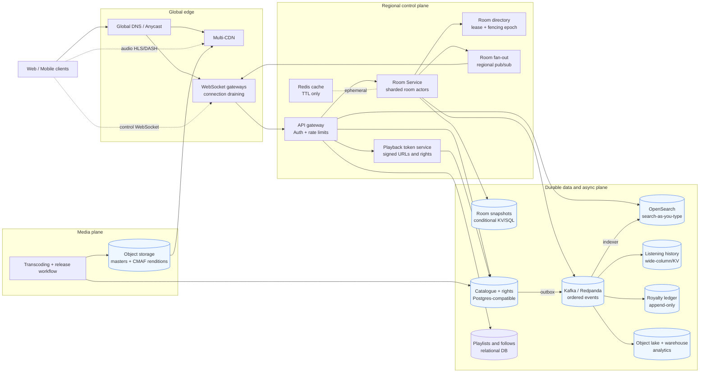
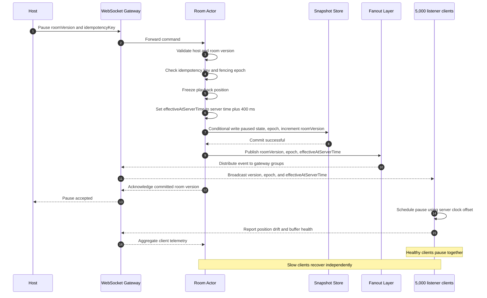

# Music Streaming with Shared Listening Rooms

**Scope:** backend and system architecture for 20M monthly users, 2M peak concurrent listeners, 50M tracks, and 200k open shared rooms.

## 1. Goals and guiding decisions

The product has two different workloads:

1. **Audio delivery:** large, cacheable bytes that should travel from object storage through a CDN directly to each listener.
2. **Room control:** tiny, low-latency commands and playback timestamps that should travel through a stateful room service.

Separating these workloads is the central decision. A room server never proxies or relays audio. It only publishes the logical playback timeline, queue changes, and control commands. This means a room with 5,000 listeners creates approximately 5,000 WebSocket fan-out messages for a pause, but does not create 5,000 copies of the audio stream at the room service.

The design uses the following consistency boundaries:

- **Room state:** strongly ordered per room. Each command has a monotonically increasing `roomVersion` and a fencing `epoch`.
- **Playback:** clients converge on a server-defined timeline. Audio bytes are independently fetched and may be buffered differently.
- **Search and analytics:** intentionally eventually consistent. A new release can appear in the catalogue before every search replica has indexed it.
- **Royalties:** append-only and auditable. Events are deduplicated by event ID before they enter the payable ledger.

The target is p95 absolute playback drift under 200 ms for healthy clients, not a promise that a disconnected or severely bandwidth-constrained client can hear the room in real time.

See the [architecture diagram](diagrams/architecture.mmd) for the component layout.



## 2. Audio delivery and fast playback

### Ingest and storage

An upload/release workflow validates metadata, runs malware and media checks, and sends the source master to versioned object storage such as S3. A transcoding fleet produces aligned AAC/Opus renditions at several bitrates (for example 64, 128, 256, and 320 kbps). Every rendition uses the same track timeline, keyframe/segment boundaries, codec parameters, and duration metadata. CMAF/fMP4 segments are preferable because the same media packaging can support HLS and DASH.

The source master is retained in a restricted bucket. Packaged segments and manifests live in a separate origin bucket with immutable content-addressed paths, for example `track/{assetVersion}/{bitrate}/{segmentNumber}`. Immutable paths make CDN invalidation unnecessary for normal playback and allow a release to be rolled back by changing the catalogue's active asset version.

### CDN and adaptive bitrate

Clients use a signed, short-lived manifest URL. The CDN caches manifests briefly and media segments for a long time. Origin Shield plus multi-CDN routing protects the object store from a release-day cache miss. A client selects bitrate from bandwidth, device capability, and buffer health; it can fall to a lower rendition without changing the room timeline because all renditions are aligned.

The default segment duration is around 1–2 seconds. This is a compromise: shorter segments reduce recovery and start latency but increase request overhead. The room protocol supplies sub-segment timing; segment boundaries do not need to be the synchronization resolution.

For fast start, the playback service returns the track metadata and manifest URL in the same response as the room snapshot. The client prefetches the first media segments while opening the WebSocket. A newly selected track is announced before the current track ends, allowing clients to prefetch the next manifest and first segment. If the CDN is cold, an origin shield and pre-warmed popular releases reduce the first-byte penalty.

Licensing, DRM, territory restrictions, and explicit-content policy are enforced when the playback token is issued. They are not bypassed by the room protocol: a listener who cannot legally play an asset receives a room state but not an audio token.

## 3. Catalogue, search, and publishing

The canonical catalogue is a partitioned Postgres-compatible relational store. It holds artists, albums, tracks, versions, territories, rights windows, and relationships. This is a good fit for transactional publishing and relational integrity; 50M tracks is large but well within the range of a partitioned, replicated relational catalogue with read replicas.

Search is a separate OpenSearch cluster. It stores denormalized documents containing title, artist, album, normalized tokens, popularity, language, and availability filters. Search-as-you-type uses a completion/edge-ngram field and a small suggestion index. Results are filtered by the caller's territory and rights timestamp.

Publishing is an idempotent workflow:

1. Write a release and its asset version in a transaction with status `PROCESSING`.
2. Transcode and validate every required rendition.
3. Store an outbox record in the same transaction as the catalogue status change to `PUBLISHED`.
4. A relay publishes the outbox record to the event bus; an indexer updates OpenSearch through an alias.
5. The playback-token service checks the active asset version and rights before serving it.

The outbox removes the dual-write gap between the catalogue and search/indexing events. Consumers are idempotent, so retries cannot create duplicate tracks. Search can briefly lag publication; direct track lookup still works from the canonical catalogue.

## 4. Room synchronization model

### Room ownership and state

The Room Service is a sharded set of room actors. A consistent-hash directory maps `roomId` to an actor shard. Only the actor holding the current lease and `epoch` may mutate a room. WebSocket gateways hold client connections and route commands to the actor; they are deliberately stateless with respect to room state.

The durable room snapshot contains:

```text
roomId, hostId, epoch, roomVersion
trackId, assetVersion, state (PLAYING|PAUSED)
anchorPositionMs, anchorServerTimeMs
queue, queueRevision, currentQueueIndex
permissions, createdAt, lastActivityAt
```

While playing, the logical position is:

```text
position(now) = anchorPositionMs + (now - anchorServerTimeMs)
```

The actor serializes commands, computes a new anchor, increments `roomVersion`, persists the new snapshot using a conditional write, and publishes the resulting event. A command includes an idempotency key. Repeated client retries return the same version rather than applying the action twice.

The room snapshot is stored in a strongly consistent, multi-AZ key-value store with conditional writes and synchronous replication to a paired failover region (for example, a multi-region SQL/KV equivalent). A single-home-region deployment can be used for the first milestone, but it has a bounded regional-outage recovery point and does not provide the synchronous failover guarantee described below. A compact room event stream is retained in Kafka/Redpanda for replay, analytics, and audit. The database snapshot is the fast recovery point; the stream is not required for every live read.

### Clock and drift control

On WebSocket connect, the client performs several ping/pong exchanges and estimates server clock offset using the minimum round-trip sample. Room events include `effectiveAtServerTime`, so a pause or seek is scheduled in the future (normally 300–500 ms) instead of taking effect when each packet happens to arrive.

Clients send a small playback telemetry message periodically and after a correction. A client compares its decoder position with the expected room position:

- drift ≤ 60 ms: do nothing;
- drift between 60 and 200 ms: adjust playback rate briefly, for example 0.98–1.02x;
- drift > 200 ms, a missed command, or a track boundary mismatch: seek to the expected position and rebuffer;
- no media or no WebSocket: show a reconnect/buffering state and catch up from the latest snapshot.

The server sends a sync beacon every few seconds, but it can coalesce beacons for a large room because all beacons carry the same current version and timeline. A client is not allowed to hold the room back: slow clients correct themselves or fall behind visibly.

### Late joiners

The join endpoint atomically returns a signed playback token, a room snapshot, the latest queue revision, and a WebSocket resume token. The client opens the socket, validates `epoch`/`roomVersion`, calculates the current position from `anchorServerTime`, and starts at that position. If the room is paused, it loads and waits at the paused position. Snapshot plus version validation prevents a late joiner from replaying stale queue or pause events.

### A host pause in a 5,000-listener room

The host sends `Pause(roomVersion, idempotencyKey)` to any gateway. The actor rejects a stale version, verifies its fencing `epoch`, freezes the current position, persists the new state with a conditional write, and chooses `effectiveAtServerTime = serverNow plus 400 ms`. It publishes one small event containing `roomVersion`, `epoch`, and `effectiveAtServerTime` to the room fan-out layer. Gateways broadcast the same event to all 5,000 sockets; they do not independently calculate a different pause time. Each client pauses at `effectiveAtServerTime`, reports the observed drift, and corrects if necessary.

The full flow is in the [pause sequence diagram](diagrams/host-pause.mmd).



## 5. Data and storage choices

| Data | Primary store | Why |
| --- | --- | --- |
| Source masters, packaged audio, artwork | Object storage + CDN | Durable, cheap, immutable objects; CDN handles read scale |
| Catalogue and rights | Postgres-compatible relational DB | Transactions, constraints, joins, auditable publishing |
| Search and suggestions | OpenSearch | Inverted index, prefix completion, relevance, filtering |
| Room snapshot and queue | Strongly consistent KV/SQL store | Conditional versions, low-latency point reads, per-room serialization |
| Room/control/event stream | Kafka/Redpanda + object-storage archive | Ordered partitions, replay, decoupled consumers, audit trail |
| Playlists and follows | Relational DB, partitioned by user | User-owned transactional lists and ordering |
| Recent listening history | Wide-column/KV store keyed by user and time | High append rate and efficient recent-history reads |
| Royalty ledger | Immutable event log + warehouse/ledger tables | Deduplication, replay, reconciliation, auditability |
| Analytics and aggregates | Object-storage lake + ClickHouse/warehouse | Cheap retention and fast time-series/grouped queries |
| Ephemeral cache, rate limits, presence | Redis-compatible cluster | TTL data only; not the source of truth |

Listening events carry `eventId`, `userId`, `roomId`, `trackId`, `assetVersion`, `startedAt`, `playedMs`, client quality fields, and a producer/schema version. The online history consumer writes a user timeline; the royalty consumer applies rights rules and deduplicates by `eventId`; the analytics consumer writes both raw events to the lake and low-latency aggregates. A room command being accepted is not blocked on analytics or royalty processing.

## 6. Reliability and graceful degradation

The service runs across at least three availability zones per region. The room directory, gateways, actors, and consumers scale independently. Room actors checkpoint after every accepted mutation, and the fan-out layer can be rebuilt from the latest snapshot.

### Failure scenarios

1. **Room actor crashes or its node is lost.** The lease expires, a replacement actor acquires a higher fencing epoch, loads the snapshot, and resumes from the same timeline. Gateways reconnect the room stream and discard events from an older epoch. A command may need to be retried, but split-brain actors cannot both mutate the room.

2. **A WebSocket gateway crashes.** Clients reconnect with their room ID and resume token through any healthy gateway. The gateway obtains a fresh snapshot and latest version; the audio CDN continues independently. Reconnect jitter is bounded so a fleet failure does not create a reconnect storm.

3. **A listener has slow or intermittent bandwidth.** The room remains on its global timeline. The client lowers bitrate, uses its buffer, and then seeks to the current playhead if it falls over 200 ms behind. Slow clients are removed from high-frequency telemetry when overloaded; they never block room fan-out.

4. **A CDN edge or origin has elevated errors.** The playback token can select a second CDN. Clients retry with exponential backoff, switch rendition, and use already-buffered media. The room control plane continues. If a listener cannot fetch the next segment, that listener buffers while the rest of the room proceeds.

5. **The event bus is delayed or unavailable.** Live room commands use the room store and regional fan-out path, not the analytics consumers. The event bus is retried through a durable outbox; analytics and royalty views become stale but accepted control actions remain available. If the room store itself is unavailable, the service rejects mutations instead of acknowledging state it cannot persist.

6. **A whole region is unavailable.** Audio objects are replicated and served through a multi-region/multi-CDN origin. A global room directory routes reconnects to the paired region. The standby actor acquires a fencing token and restores the latest synchronously replicated snapshot; clients receive a new epoch and resync. The explicit trade-off is a short control-plane interruption during failover, while already-buffered audio may continue. A command that was still in flight during the outage may be retried with its idempotency key; a committed room mutation is not acknowledged until it is durably accepted by the room store.

7. **A release is published with one bad rendition or incomplete index.** The asset remains `PROCESSING` until validation passes for every required rendition. The catalogue outbox and indexer are idempotent. A failed index update is retried without republishing the track, and the active asset version can be rolled back.

8. **A 5,000-member room overloads a fan-out shard.** Room membership is split across gateway groups while the actor remains single-writer. Sync beacons are coalesced, queue mutations are rate-limited, and per-client send queues have deadlines. Control events are prioritized over telemetry. A room can continue with fewer beacons while clients use the last valid timeline.

### Deploys without dropping live rooms

Gateways use connection draining: new sockets go to the new pool while existing sockets stay connected until a deadline or a graceful handoff. Actors use a versioned protocol and rolling ownership transfer. A new actor loads the snapshot, verifies the current epoch, then takes the lease; the old actor stops accepting commands before releasing it. Blue/green deployment, backward-compatible event schemas, and a kill switch for new room creation reduce blast radius. No deployment requires all 200,000 rooms to restart at once.

## 7. Observability: prove synchronization is working

Every client telemetry sample is tagged with room, region, gateway, client platform, track, bitrate, and protocol version. Do not rely only on server-side WebSocket health; synchronization is a user-side property.

The primary service-level indicators are:

- p50/p95/p99 absolute playback drift, measured against expected room position;
- percentage of healthy listeners within 100 ms and 200 ms;
- pause/seek propagation latency from accepted command to client-applied timestamp;
- late-join time to first audio and time to join the current playhead;
- hard correction rate, rebuffer rate, and track-boundary mismatch rate;
- WebSocket reconnect rate, resume success rate, and stale-epoch event count;
- fan-out publish latency, gateway send-queue depth, dropped/coalesced beacon count, and per-room listener count;
- CDN cache hit ratio, time to first byte, segment error rate, bitrate switches, and origin load;
- room-store conditional-write conflicts/latency, lease failovers, event-bus lag, outbox age, and search indexing lag.

Dashboards should show distributions, not only averages, split by region, device, network type, bitrate, and room size. A synthetic client fleet should join rooms of 2, 100, and 5,000 listeners and continuously assert that the p95 drift SLO holds. Correlating `roomVersion`, `epoch`, `effectiveAtServerTime`, and client telemetry makes a single bad pause traceable end to end.

## 8. Alternatives rejected

- **Relay one audio stream from the room server:** rejected because bandwidth and egress grow with room membership and a single hot room becomes a bottleneck. CDN delivery scales independently.
- **Use only client timestamps or host-to-client commands:** rejected because clock differences, packet delay, and host disconnects make pause/seek timing inconsistent. The server-owned timeline and scheduled effective time are deterministic.
- **Use Redis as the durable room database:** rejected because cache eviction and weaker durability are dangerous for queue/control state. Redis remains useful for ephemeral presence and rate limits.
- **Use a single global room process or database writer:** rejected because cross-region latency and a global hot path would hurt all rooms. Ownership is per room, with regional locality and explicit failover.
- **Make Kafka the synchronous room database:** rejected because a log is excellent for replay but adds unnecessary latency to snapshots and late joins. The room store is the command-state source of truth; Kafka receives durable events for consumers.
- **Require every listener to acknowledge a pause before applying it:** rejected because one offline client could block 4,999 healthy listeners. The room commits once and clients converge independently.

## 9. What a team of three builds first

### First milestone

1. A single-region vertical slice: catalogue lookup, one encoded rendition, CDN/object-storage playback, room creation/join, host pause/seek, queue, and WebSocket room events.
2. Versioned room snapshots with conditional writes, idempotency keys, scheduled `effectiveAtServerTime`, client clock-offset estimation, and drift telemetry.
3. A basic relational catalogue plus outbox-driven search indexing.
4. Metrics and a synthetic test that measures pause propagation and drift for hundreds of simulated clients before attempting a 5,000-client load test.

This validates the product's riskiest claim—shared playback feels synchronized—before building every surrounding platform.

### Postpone until the core is proven

Multi-region active/active rooms, multi-CDN routing, DRM and territory complexity, advanced recommendation/search ranking, large-scale royalty settlement, creator dashboards, social moderation, voice chat, and a full data lake can follow. The first production hardening pass should still include multi-AZ recovery, connection draining, rate limits, audit logs, and a tested regional failover runbook; those are reliability essentials, not optional polish.

